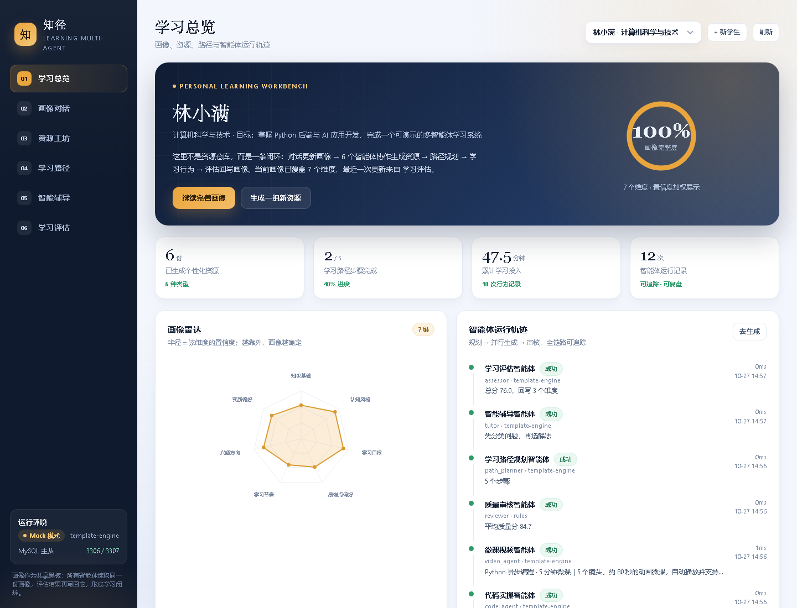
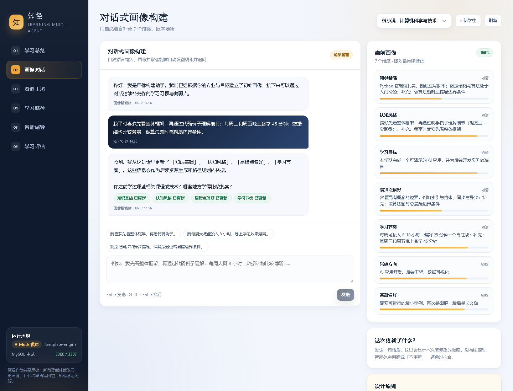
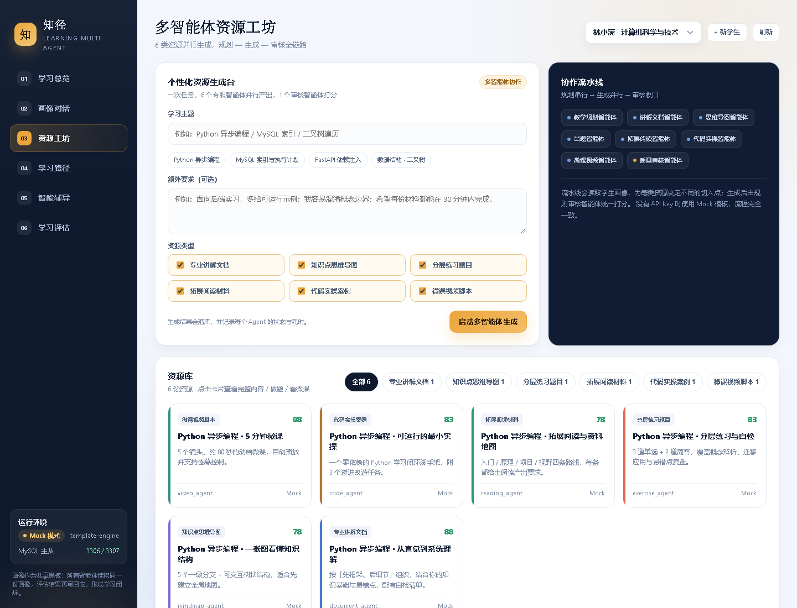
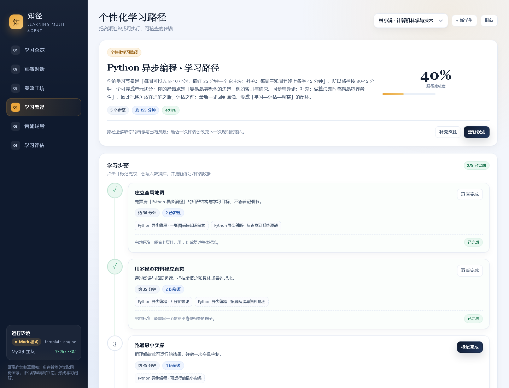
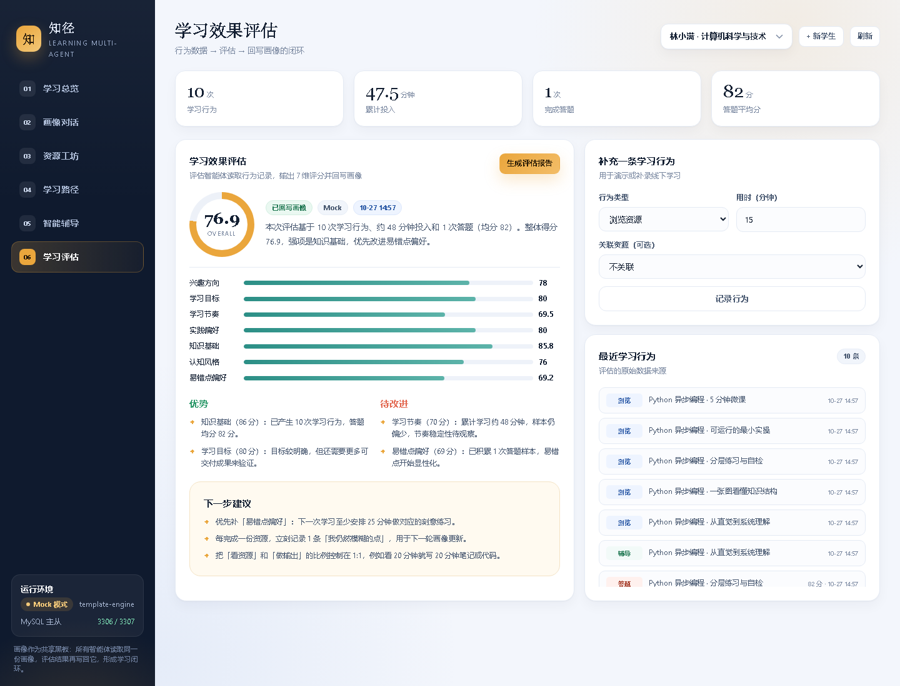
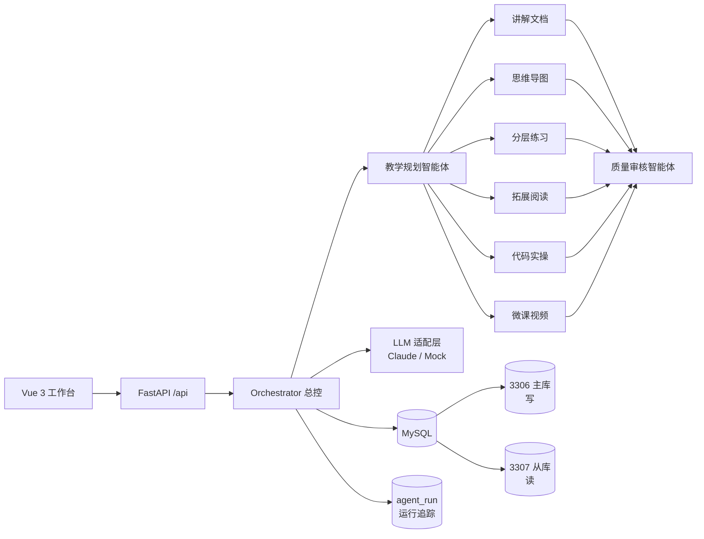

# 知径 · 个性化资源生成与学习多智能体系统

一个可以完整跑通的学习多智能体系统：**对话构建画像 → 6 类资源并行生成 → 路径规划 → 智能辅导 → 学习评估 → 评估回写画像**。

后端 FastAPI + MySQL 主从，前端 Vue 3。没有 API Key 也能用内置 Mock 模板完整演示；配置 `LLM_PROVIDER=claude` 后切换为真实大模型。



---

## 一、已实现的功能

| 课程需求 | 实现情况 |
|---|---|
| 需求 1：对话式学习画像自主构建（≥6 维，随学随新） | ✅ 7 个维度（知识基础、认知风格、学习目标、易错点偏好、学习节奏、兴趣方向、实践偏好），对话抽取、置信度、追问、评估回写 |
| 需求 2：多智能体协同生成 ≥5 类资源 | ✅ 8 个角色：规划 + 讲解文档 / 思维导图 / 分层练习 / 拓展阅读 / 代码实操 / 微课视频 + 质量审核；6 类资源并行生成 |
| 需求 3：个性化学习路径与资源推送 | ✅ 依据画像与已有资源生成 5 步路径，含目标、资源、时长、完成标准、进度持久化 |
| 需求 4：智能辅导（加分项） | ✅ 结合画像与关联资源答疑，输出结论、拆解、类比、Mermaid 结构图、下一步 |
| 需求 5：学习效果评估（加分项） | ✅ 行为记录 → 7 维评分 → 优势/薄弱点/建议 → 自动回写画像，形成闭环 |
| 工程实践：读写分离、连接池、文件上传、Swagger、Agent 可观测性 | ✅ 显式主从分流、从库降级、连接池、分片上传、`/docs`、`agent_run` 全链路追踪 |

### 界面一览

| 画像对话 | 资源工坊 |
|---|---|
|  |  |

| 学习路径 | 学习评估 |
|---|---|
|  |  |

更多资源详情截图见 `docs/screenshots/`（文档、导图、练习、代码、微课、辅导）。

---

## 二、系统架构



**核心设计：画像作为共享黑板。** 所有 Agent 从同一份画像读取需求，评估智能体再把结果写回画像；下一次资源生成和路径规划会自动使用更新后的画像。

---

## 三、快速启动

### 0. 环境要求

- Python 3.11+
- Node.js 18+
- MySQL 8.0（本机示例：主库 3306、从库 3307）

### 1. 启动数据库

本机已有环境（路径可按自己的安装位置调整）：

```bat
:: 主库 3306
C:\Users\lijun\tools\mysql-8.0.29-winx64\start_mysql.bat

:: 从库 3307（新开一个终端，在 mysql 的 bin 目录执行）
mysqld --datadir=C:/Users/lijun/tools/mysql-8.0.29-winx64/data-slave --port=3307 --server-id=2
```

> 从库没启动也能用：`db.py` 会自动把读请求降级到主库，并在日志里打 WARNING。

### 2. 初始化后端

```bash
cd backend
python -m pip install -r requirements.txt
copy .env.example .env        # Windows；macOS/Linux 用 cp
python init_db.py             # 建表 + 非破坏性迁移 + 演示学生
python -m uvicorn main:app --reload --port 8001
```

- 服务：<http://127.0.0.1:8001>
- 接口文档：<http://127.0.0.1:8001/docs>
- 健康检查：<http://127.0.0.1:8001/api/health>

### 3. 构建前端

```bash
cd frontend
npm install
npm run build                # 产物在 frontend/dist，由 8001 直接托管
```

打开 <http://127.0.0.1:8001/> 即可。

开发模式（热更新，接口代理到 8001）：

```bash
npm run dev                  # http://127.0.0.1:5173
```

### 4. 冒烟测试

```bash
cd backend
python smoke_test.py
```

会检查健康状态、主从、读写连接端口、画像维度、资源类型、当前学生资源/路径/评估。

分片上传演示（后端需已启动）：

```bash
cd backend
python test_upload.py
```

### 5. 恢复干净演示数据

```bash
cd backend
python reset_demo.py         # 只重置「林小满」，不影响其他学生
```

---

## 四、启用真实大模型

默认 `LLM_PROVIDER=mock`，用确定性模板生成内容，**不调用外部 API，不需要 Key**，适合离线演示和答辩。

要使用 Claude：

```env
# backend/.env
LLM_PROVIDER=claude
ANTHROPIC_API_KEY=sk-ant-...
LLM_MODEL=claude-opus-4-8
```

说明：

- 调用失败会重试（默认 3 次），最终降级到 Mock，并在 `agent_run` 与资源 `meta.provider` 中标记 `mock-fallback`，不会静默吞错。
- 当前安装的 `anthropic==0.75.0` 尚未在类型签名中暴露 `output_config`，代码通过 `extra_body` 传递 JSON Schema；若服务端不支持结构化输出，会退回到「提示词约束 JSON」。
- 真实模型输出会由 Pydantic / 必填字段校验，缺字段会重试。

> **安全说明**：仓库和课程笔记中的 `root123456`、`repl123456`、禅道账号等均为**本机实验环境默认值**，不是线上服务凭证。克隆后请复制 `backend/.env.example` 为自己的 `.env` 并修改密码；不要把真实密钥提交到仓库。

---

## 五、演示流程（5 分钟）

1. **画像对话**：进入「画像对话」，输入
   > 我平时喜欢先看整体框架，再通过代码例子理解细节；每周三和周五晚上各学 45 分钟；数据结构比较薄弱，做算法题时总搞混边界条件。

   观察 4 个维度被更新，并收到一个追问。
2. **资源工坊**：输入主题「Python 异步编程」，勾选 6 类资源，点击「启动多智能体生成」。
   观察规划 → 6 个 Agent 并行 → 审核，生成 6 份资源。
3. **打开资源**：文档、导图、练习（可提交并自动记录）、代码（可复制）、微课（HTML 动画，可播放）。
4. **学习路径**：生成路径，标记前两步完成，观察进度变成 40%。
5. **智能辅导**：提问「为什么异步编程在 I/O 密集场景更有优势？」，查看结论、要点、类比与下一步。
6. **学习评估**：生成报告，查看 7 维评分，并回到画像页确认评估结果已回写。
7. **总览**：查看资源数、路径进度、学习分钟数、Agent 运行轨迹。

---

## 六、主要接口

| 方法 | 路径 | 说明 |
|---|---|---|
| GET | `/api/health` | 主从、LLM 模式、服务状态 |
| GET | `/api/debug/db-route` | 证明写连接走 3306、读连接走 3307 |
| GET | `/api/meta` | 7 个画像维度、6 类资源定义 |
| GET/POST | `/api/students` | 学生列表 / 创建 |
| GET | `/api/dashboard/{student_id}` | 学习总览聚合 |
| GET | `/api/profile/{student_id}` | 画像 + 完整度 |
| POST | `/api/profile/{student_id}/chat` | 对话式画像更新 |
| GET | `/api/profile/{student_id}/dialogues` | 画像对话历史 |
| POST | `/api/resources/generate` | 多智能体生成资源 |
| GET | `/api/resources?student_id=` | 资源列表 |
| GET | `/api/resources/{id}` | 资源详情（含 meta） |
| POST | `/api/resources/{id}/view` | 记录浏览行为 |
| POST | `/api/paths/generate` | 生成学习路径 |
| GET | `/api/paths/{student_id}` | 最新路径 |
| PATCH | `/api/paths/{path_id}/steps/{no}` | 标记步骤完成 |
| POST | `/api/tutor/ask` | 智能辅导 |
| GET | `/api/tutor/history/{student_id}` | 辅导历史 |
| POST | `/api/assessment/records` | 记录学习行为 |
| POST | `/api/assessment/evaluate` | 生成评估并回写画像 |
| GET | `/api/agent-runs/{student_id}` | Agent 运行轨迹 |
| POST | `/api/upload/*` | 分片上传 / 重组 / 批量上传 |

完整交互文档见 `/docs`。

---

## 七、目录结构

```
Learning/
├── backend/
│   ├── main.py                 # 应用入口、统一异常、静态托管
│   ├── config.py               # .env / 环境变量 / 路径
│   ├── db.py                   # 连接池 + 主从读写分离 + 降级
│   ├── store.py                # 所有 SQL / JSON 序列化
│   ├── llm.py                  # LLM 适配层（Claude / Mock / 降级）
│   ├── orchestrator.py         # 总控：画像、资源、路径、辅导、评估
│   ├── agents/                 # 8 个智能体角色
│   ├── routers/                # REST 接口
│   ├── schema.sql              # 8 张表
│   ├── init_db.py              # 建表 + 增量迁移 + 种子
│   ├── reset_demo.py           # 重置演示学生
│   └── smoke_test.py           # 只读冒烟测试
├── frontend/
│   ├── src/App.vue             # 工作台布局、Hash 深链接
│   ├── src/components/         # 6 个页面 + 雷达图/导图/练习/Markdown
│   └── src/api.js              # 统一请求封装
├── docs/
│   ├── lessons/                # 课程笔记（01–21）
│   └── screenshots/            # 界面截图
├── logs/                       # 运行日志（不参与版本控制）
└── README.md
```

---

## 八、关键工程点

1. **显式读写分离**：`db.read_conn()` 走 3307，`db.write_conn()` 走 3306；不解析 SQL，避免事务/函数/注释误判。
2. **写后立刻读走主库**：生成路径后立刻查详情时曾因为主从延迟返回空对象，修复为 `use_master=True`。
3. **从库降级**：从库不可用时读请求自动降级主库，健康检查会显示 `replica_fallback`。
4. **连接池**：LIFO 复用、池满等待、`ping(reconnect=True)`、释放前 rollback，避免状态泄漏。
5. **Agent 可观测性**：每次运行写入 `agent_run`（角色、状态、模型、耗时、输入/输出摘要、错误），前端时间线可复盘。
6. **结构化输出 + 降级**：JSON Schema 约束 → 必填校验 → 重试 → Mock 降级，保证流水线不会因单个 Agent 失败而整体不可用。
7. **多模态资源**：微课不是一段文字，而是生成独立的 HTML 动画播放器（含分镜、旁白、自动播放、进度条），存路径、不存数据库。
8. **安全细节**：上传文件名去路径分隔符防目录穿越；Markdown 经 DOMPurify 清洗后再渲染。

---

## 九、验证记录（2026-10-27）

- 主库 3306 / 从库 3307 复制正常，健康检查均为 `ok`。
- 一次生成 6 类资源，Mock 模式约 **2.2 秒**，平均质量分 **84.7**。
- 路径生成 5 步，前两步标记完成后进度 **40%**。
- 演示学生累计 10 次学习行为、约 47.5 分钟、1 次答题（82 分）。
- 评估报告总分 **76.9**，7 维评分 + 优势/薄弱点/建议，并回写 3 个画像维度。
- Agent 追踪覆盖画像抽取、规划、6 个生成、审核、路径、辅导、评估。

---

## 十、已知限制与下一步

| 项 | 现状 | 下一步 |
|---|---|---|
| Mock 内容 | 模板化、结构完整，但具体知识需要真实模型 | 配置 Claude 后重新生成；补充课程知识库 |
| 微课 | 生成 HTML 动画 + 分镜脚本，不是 MP4 | 接入 TTS / Remotion / 视频渲染 |
| RAG | 未接入向量库 | 增加课程资料入库与检索，生成前先检索 |
| 鉴权 | 演示项目，学生选择器直接切换 | 加登录、JWT、按学生隔离数据 |
| 生成方式 | 同步请求，前端等待 | 改为后台任务 + 任务状态轮询/SSE |
| 前端工程 | Vite 单页，无路由库 | 引入 Vue Router / Pinia（如规模扩大） |

---

## 十一、课程笔记

- [18-多智能体编排与结构化输出](docs/lessons/18-多智能体编排与结构化输出.md)
- [19-连接池与主从读写分离实战](docs/lessons/19-连接池与主从读写分离实战.md)
- [20-LLM适配层与Mock降级](docs/lessons/20-LLM适配层与Mock降级.md)
- [21-Vue工作台与前后端联调](docs/lessons/21-Vue工作台与前后端联调.md)

更早的工程基础、MySQL、Nginx、文件上传、禅道 RBAC 笔记见 `docs/lessons/`。

---

## 十二、常用命令

```bash
# 后端
cd backend
python init_db.py
python -m uvicorn main:app --reload --port 8001
python smoke_test.py
python reset_demo.py

# 前端
cd frontend
npm run dev
npm run build
```

> 端口约定：8000 被本机 C-Lodop 占用，项目固定使用 **8001**；Nginx 入口为 **8088**。
