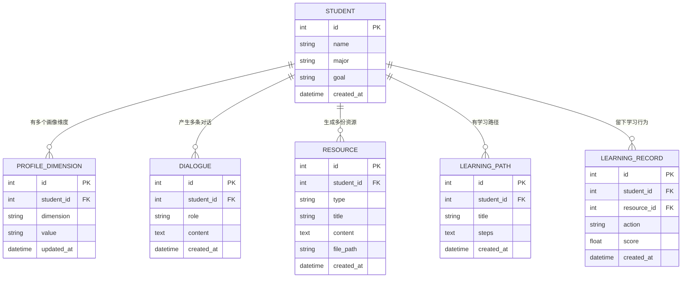

# 第 9 课 · 配套：数据模型设计（精简版）

> **日期**：2026-10-26
> **目标**：为"换 MySQL"准备一套像样的表结构。先建模，再建表。
> **原则**：能少就少，只建撑起核心需求（画像 / 对话 / 资源 / 路径）的表，加分项表先放着。

---

## 一、ER 图

**关系一句话总结**：所有表都是「**围绕学生的一对多**」。一个学生 → 多条画像维度 / 多条对话 / 多份资源 / 多条学习路径 / 多条行为记录。**目前没有多对多**，等你发现"一个资源被多个路径引用"这类需求时，再引入中间表。

---

## 二、每张表说明

### 1. `student`（学生）

| 字段 | 类型 | 说明 |
|---|---|---|
| `id` | int, PK | 主键 |
| `name` | varchar | 名字 |
| `major` | varchar | 专业 |
| `goal` | varchar | 学习目标 |
| `created_at` | datetime | 创建时间 |

这就是你现有 `students` 表的升级版（多了 `goal` 你已经加过，这里加上时间戳）。

### 2. `profile_dimension`（画像维度）★ 本设计最重要的一个决定

| 字段 | 类型 | 说明 |
|---|---|---|
| `id` | int, PK | 主键 |
| `student_id` | int, FK | 属于哪个学生 |
| `dimension` | varchar | 维度名：知识基础 / 认知风格 / 易错点偏好 / … |
| `value` | text | 该维度的值（可能是 JSON） |
| `updated_at` | datetime | 最近更新时间 |

**关键：画像的 6 个维度，做成"6 行"，而不是"6 列"。**

两种做法对比：

| 做法 | 长什么样 | 加第 7 维时 |
|---|---|---|
| **6 列**（宽表） | `knowledge` / `style` / `weakness` … 各一列 | `ALTER TABLE` 加列，还要改所有相关代码 |
| **6 行**（长表） | 一行 = 一个维度 | 插入一行，什么都不用改 |

你的需求里有"**随学随新**"——维度会变、值会更新、将来还可能冒出第 7、第 8 维。**长表天然支持这种"会变的数量"。** 这是数据建模里最经典的权衡之一（宽表 vs 长表），值得你记住。

> 配套约束：给 `(student_id, dimension)` 加唯一约束，避免同一个学生的同一个维度存出两行。

### 3. `dialogue`（对话记录）

| 字段 | 类型 | 说明 |
|---|---|---|
| `id` | int, PK | 主键 |
| `student_id` | int, FK | 谁在聊 |
| `role` | varchar | `user`（学生）/ `assistant`（智能体） |
| `content` | text | 一句话 |
| `created_at` | datetime | 时间 |

对话是"对话式画像构建"的原料——Agent 要从历史对话里抽画像，所以**必须落库**，不能只在内存里。

### 4. `resource`（学习资源）

| 字段 | 类型 | 说明 |
|---|---|---|
| `id` | int, PK | 主键 |
| `student_id` | int, FK | 为谁生成 |
| `type` | varchar | `document` / `mindmap` / `exercise` / `reading` / `video` / `code` |
| `title` | varchar | 标题 |
| `content` | text | 正文（文本类资源直接存；结构化内容存 JSON） |
| `file_path` | varchar | 大文件（视频等）分片上传后的存储路径 |
| `created_at` | datetime | 时间 |

**关键：5 种资源类型用 `type` 字段区分，而不是建 5 张表。** 因为它们 90% 的字段一样。这里给你留了 `file_path` 字段，正好对上分块三.2 的"大文件分片上传"——视频/动画这类大文件不存数据库，存文件系统或 OSS，数据库只存路径。

### 5. `learning_path`（学习路径）

| 字段 | 类型 | 说明 |
|---|---|---|
| `id` | int, PK | 主键 |
| `student_id` | int, FK | 谁的路径 |
| `title` | varchar | 路径名 |
| `steps` | text | 步骤顺序（JSON 数组，如 `[{"no":1,"resource_id":3}, …]`） |
| `created_at` | datetime | 时间 |

路径的步骤用 JSON 存，先别拆成单独的表——路径会频繁整条重算（评估→更新画像→重算路径这条闭环），拆太细现在反而碍事。

### 6. `learning_record`（学习行为 / 评估）· 加分项，先建好备用

| 字段 | 类型 | 说明 |
|---|---|---|
| `id` | int, PK | 主键 |
| `student_id` | int, FK | 谁 |
| `resource_id` | int, FK | 看了哪份资源（可空） |
| `action` | varchar | `view` / `answer` / `feedback` … |
| `score` | float | 答题得分（可空） |
| `created_at` | datetime | 时间 |

这是需求 5（学习效果评估）的数据来源。现在先建表，字段后续随评估逻辑再加。

---

## 三、三个你该记住的设计点

1. **画像维度用"行"不用"列"**（长表 vs 宽表）—— 应对"会变的数量"
2. **资源用 `type` 区分，不拆多表** —— 应对"同类但略有差异的东西"
3. **大文件只存路径，不存文件本身** —— 数据库存"值"便宜，存"大坨字节"贵

---

## 四、下一步：建模工具 + 建表

这套结构接下来要用**建模工具**画出来（满足分块三.3"必须用建模工具建表"），然后**正向工程**生成 DDL 在 MySQL 里建表。具体工具选哪个、MySQL 装哪，等你看完这份表、确认没问题后再定。

---

## 五、我的理解（这一节由你自己填）

- 我最认可 / 最怀疑的设计点是：
- 我还没完全弄明白的地方是：
- 我踩到的坑 / 犯的错：

---

## 六、备忘

- 本机 MySQL 已装好：**8.0.29**，位置 `C:\Users\lijun\tools\mysql-8.0.29-winx64`，root 密码 `root123456`，端口 3306，字符集 utf8mb4
- 启动/停止脚本：`start_mysql.bat` / `stop_mysql.bat`（在 mysql 目录下）；当前是后台进程跑，未装成 Windows 服务（装服务需管理员）
- 表清单：`student` / `profile_dimension` / `dialogue` / `resource` / `learning_path` / `learning_record`
- 所有关系 = 学生一对多，暂无多对多
