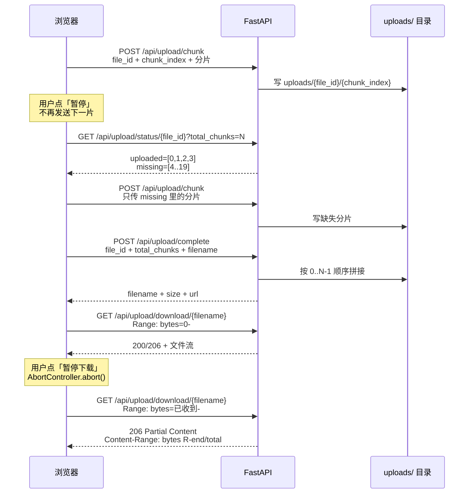

# 原理流程：上传 / 下载断点续传与进度条

> 这是一份**原理与流程参考**，不负责录屏口播。
> 录屏脚本见 `docs/演示脚本-上传下载断点续传.md`；
> 课程讲解见 `docs/lessons/22-断点续传与进度条.md`。
>
> 对应页面：`http://127.0.0.1:8001/#upload`
> 对应代码：`backend/routers/upload.py`、`frontend/src/components/UploadLab.vue`

---

## 一、一句话原理

> **上传断点续传 = 分片落盘 + 查询已上传分片 + 只补缺失；**
> **下载断点续传 = HTTP Range + 206；**
> **进度条 = 真实字节事件累加。**

---

## 二、端到端流程



### 上传时序

```text
选择文件
  → 计算 total_chunks = ceil(size / chunkSize)
  → 生成/恢复 file_id（文件名+大小+修改时间做指纹）
  → 循环上传未完成分片
  → 每片完成：服务端落盘，前端 completedBytes += 片大小
  → 用户暂停：停止发送下一片
  → 用户继续：GET status → 只传 missing
  → 全部到齐：POST complete → 拼接 → 清理临时目录
```

### 下载时序

```text
开始下载
  → fetch GET /download/{filename}（首次无 Range）
  → 服务端返回 200 + Content-Length
  → ReadableStream 逐块读，downloadedBytes += 块大小
  → 用户暂停：AbortController.abort()
  → 继续：Range: bytes={downloadedBytes}-
  → 服务端返回 206 + Content-Range
  → 追加读取，直到 done
  → Blob 保存
```

---

## 三、上传：数据契约

### 请求

```http
POST /api/upload/chunk
Content-Type: multipart/form-data

file_id=1f0c...-uuid
chunk_index=0
file=<binary>
```

| 字段 | 说明 |
|---|---|
| `file_id` | 本次上传的唯一标识，浏览器生成；同名文件尽量复用 |
| `chunk_index` | 分片序号，从 0 开始 |
| `file` | 分片二进制 |

### 服务端落盘

```text
uploads/
└── {file_id}/
    ├── 0
    ├── 1
    ├── 2
    └── ...
```

分片文件名就是序号，因此：

- 乱序到达没问题；
- 重复上传同一序号会覆盖，天然幂等；
- 合并时必须按 `0..N-1` 顺序读，不能依赖目录遍历顺序。

### 断点查询

```http
GET /api/upload/status/{file_id}?total_chunks=20
```

```json
{
  "file_id": "1f0c...",
  "uploaded": [0, 1, 2, 3],
  "missing": [4, 5, "...", 19],
  "uploaded_count": 4
}
```

前端逻辑：

```js
const status = await api.uploadStatus(fileId, totalChunks)
const uploaded = new Set(status.uploaded)
for (let i = 0; i < totalChunks; i++) {
  if (uploaded.has(i)) continue
  await uploadChunk(i)
}
```

### 合并

```http
POST /api/upload/complete

file_id=1f0c...
total_chunks=20
filename=demo-20mb.bin
```

服务端按 0..N-1 顺序 `shutil.copyfileobj`，成功后 `rmtree(chunk_dir)`。

---

## 四、下载：数据契约

### 首次下载

```http
GET /api/upload/download/demo-20mb.bin
```

响应：

```http
HTTP/1.1 200 OK
Accept-Ranges: bytes
Content-Length: 20971520
Content-Disposition: attachment; filename*=UTF-8''demo-20mb.bin
```

### 断点下载

```http
GET /api/upload/download/demo-20mb.bin
Range: bytes=5177344-
```

响应：

```http
HTTP/1.1 206 Partial Content
Accept-Ranges: bytes
Content-Range: bytes 5177344-20971519/20971520
Content-Length: 15794176
```

| 响应头 | 前端用来做什么 |
|---|---|
| `206 Partial Content` | 确认服务端接受了 Range |
| `Content-Range` | 解析总大小，计算下载百分比 |
| `Content-Length` | 本次要接收的字节数 |
| `Accept-Ranges: bytes` | 告诉客户端可以按字节范围请求 |

### 关键边界

- 如果服务端返回 **200** 而不是 206，说明 Range 被忽略（代理/服务器不支持）。前端必须**清空已下载分片，从 0 重新接收**，否则会把完整文件追加到已有数据后面，文件损坏。
- 如果返回 **416**，说明请求范围超出文件大小，应该重新从 0 下载。
- 如果文件在下载过程中被覆盖，Range 可能对应到错误内容；生产环境应加 `ETag` / `If-Range` / 文件版本。

---

## 五、进度条公式

### 上传

```text
completedBytes = 已完成分片的字节数之和
currentLoaded  = 当前分片 xhr.upload.onprogress 的 loaded
progress       = (completedBytes + currentLoaded) / file.size
```

为什么不能只看当前片？因为当前片只占 1MB，文件有 20MB；只看当前片进度永远在 0–5% 之间跳。

### 下载

```text
downloadedBytes = 已读到的所有 Uint8Array 长度之和
progress        = downloadedBytes / downloadTotal
```

`downloadTotal` 来源：

1. 206 响应的 `Content-Range: bytes start-end/total`；
2. 200 响应的 `Content-Length`；
3. 上传完成时后端返回的 `size`。

---

## 六、代码映射

| 层 | 位置 | 责任 |
|---|---|---|
| 后端分片落盘 | `upload.py::upload_chunk` | 接收分片，写 `uploads/{file_id}/{index}` |
| 后端断点查询 | `upload.py::upload_status` | 扫描目录，返回 uploaded / missing |
| 后端合并 | `upload.py::complete_upload` | 按序拼接，清理临时目录 |
| 后端 Range | `upload.py::download` | 解析 Range，返回 206 / 416 / 200 |
| 前端切片 | `UploadLab.vue::uploadMissingChunks` | `file.slice` + 只传 missing |
| 前端上传进度 | `UploadLab.vue::uploadChunk` | XHR `upload.onprogress` |
| 前端下载 | `UploadLab.vue::startDownload` | `fetch` + `ReadableStream` + Range |
| 前端暂停 | `AbortController` | 中断连接，保留已收字节 |

---

## 七、小文件批量上传

### 1. 实现方式

```text
选择多个小文件
  → 全部 append 到同一个 FormData 的 files 字段
  → 一次 POST /api/upload/batch
  → 后端 upload_batch 循环落盘
  → 返回 count / total_size / files 列表
```

前端：`UploadLab.vue::uploadBatch`

```js
const form = new FormData()
batchFiles.forEach((item) => form.append('files', item.file, item.name))
xhr.open('POST', '/api/upload/batch')
xhr.upload.onprogress = ...   // 整体进度，不是每个文件单独进度
```

后端：`upload.py::upload_batch`

```python
for f in files:
    safe_filename = _safe_name(f.filename, "unnamed.bin")
    with (UPLOAD_ROOT / safe_filename).open("wb") as out:
        shutil.copyfileobj(f.file, out)
```

返回：

```json
{
  "count": 5,
  "total_size": 936960,
  "files": [
    {"filename": "small-demo-1.txt", "size": 185344, "url": "/uploads/small-demo-1.txt"}
  ]
}
```

### 2. 为什么要批量？

- 小文件的瓶颈通常不是带宽，而是**文件数量、连接次数、元数据操作**。
- 一次请求带多个文件，减少了 HTTP 建连和请求头开销。
- 适合头像、图标、小段文本、配置等“数量多、单个小”的场景。

### 3. 批量上传不是万能的

| 限制 | 说明 |
|---|---|
| 没有单文件进度 | 一个 XHR 只有整体 `upload.onprogress` |
| 没有断点续传 | 一次请求要么成功，要么失败；失败通常整批重来 |
| 请求体有上限 | 文件太多/太大时，网关或服务器会拒绝 |
| 单文件失败影响整批 | 生产环境通常要逐文件返回结果或拆成小批次 |
| 超大文件不适合 | 仍然应该走分片上传 + `status` + `complete` |

> 生产环境常见做法：小文件打包成 ZIP/TAR 一次传；或者对象存储的批量接口；或者后台任务逐文件处理并记录每个文件的状态。

### 4. 页面演示

左侧「07 上传实验」→ 第三块 **3. 小文件批量上传** → 「使用 5 个小文件演示」→「开始批量上传」。
代码位置：`UploadLab.vue::uploadBatch`、`upload.py::upload_batch`。

---

## 八、为什么在项目里单独开一个「上传实验」页面？

这不是为了“多做一个页面”，而是为了让一个**基础设施能力**变得可演示、可验证、可复用。

### 1. 关注点分离

- 学习工作台的业务是：画像、资源、路径、辅导、评估。
- 文件传输是底层能力：分片、临时目录、Range、进度、暂停。
- 如果把上传混进「资源工坊」，业务状态和传输状态会纠缠在一起：生成资源、选文件、分片进度、暂停按钮会互相干扰。
- 单独开页，等于把「基础设施 demo」和「业务 demo」分开；`backend/routers/upload.py` 本来也是独立路由，前端页面与后端边界一致。

### 2. 可演示（录屏价值）

- Swagger 能调接口，但看不到浏览器的 `upload.onprogress`、暂停后的分片状态、`AbortController` 的下载暂停。
- 命令行 `test_upload.py` 能验证字节一致，但无法展示进度条和用户交互。
- 单独的页面可以放 **20MB 演示文件**、**演示限速**、**分片方格**、**运行日志**，两分钟就能讲清“断点续传不是重传整个文件”。

### 3. 可验证（工程价值）

- 页面不依赖学生画像和业务数据，可以在数据库异常时独立验证文件传输。
- 可以用浏览器自动化完整跑「暂停 → 继续 → 合并 → 下载暂停 → 继续 → 保存」，本项目的 Playwright 测试就是这么做的。
- 如果以后资源上传（头像、课件、视频）要复用分片逻辑，这个页面就是现成的参考实现和回归测试入口。

### 4. 可复用

- 后端接口是通用的：任何业务都可以调用 `/upload/chunk`、`/upload/status`、`/upload/complete`。
- 前端 `UploadLab.vue` 里的 `uploadChunk`、`uploadMissingChunks`、`startDownload` 可以抽成组件/组合式函数，供资源上传复用。
- 现在单独放，先保证边界清晰，避免过早耦合。

### 5. 教学价值

- 这个页面的目的不是“业务功能”，而是把一个**容易被含糊带过的工程点**（断点续传、Progress、Range）做成可观察对象。
- 对课程答辩来说，老师能直接看到：分片、已上传状态、缺失分片、206 响应、日志、保存文件。
- 对你自己来说，调试时不用在业务页面里翻 Network 面板，页面上就有状态。

### 6. 成本很低

- 新增 1 个 Vue 页面 + 2 个后端接口（status / download），不影响原有业务。
- 页面数据不写业务表，只使用 `uploads/` 目录；失败也不会污染学生画像。
- 如果未来不想在正式产品里暴露，可以隐藏左侧导航或加权限，接口仍然可复用。

### 7. 为什么不做成独立仓库/独立服务？

- 它和主项目共享 FastAPI、静态托管、设计系统、上传目录；拆出去会增加部署和联调成本。
- 当前阶段的目标是“把原理讲清楚 + 能复用”，一个页面足够；等它真的成为独立文件服务，再拆分。

> **一句话：单独开页面，是为了让“文件传输”从业务里解耦出来，变成一个可演示、可测试、可复用的教学实验台，而不是把 demo 代码塞进业务流程。**

---

## 九、生产环境还要补什么

| 问题 | 现在的做法 | 生产建议 |
|---|---|---|
| 文件指纹 | 文件名 + 大小 + 修改时间 | 内容哈希（SHA-256） |
| 合并校验 | `test_upload.py` 做 MD5 | 服务端合并后计算哈希并比对 |
| 临时分片清理 | 合并成功即删除 | 定时任务清理超时未完成分片 |
| 并发 | 同序号覆盖 | 唯一临时文件名 + 原子重命名 / 锁 |
| 下载暂存 | 浏览器内存 | File System Access API 写磁盘 |
| Range 兼容 | 后端显式返回 206 | 加 `ETag` / `If-Range` / CDN 配置 |
| 鉴权 | 演示用 | 上传 token、大小/类型限制、病毒扫描 |

---

## 十、相关文件

- 录屏脚本：`docs/演示脚本-上传下载断点续传.md`
- 课程笔记：`docs/lessons/22-断点续传与进度条.md`
- 后端：`backend/routers/upload.py`
- 前端：`frontend/src/components/UploadLab.vue`
- 命令行验证：`backend/test_upload.py`
- 截图：`docs/screenshots/upload-lab.png`、`upload-paused.png`、`upload-done.png`
